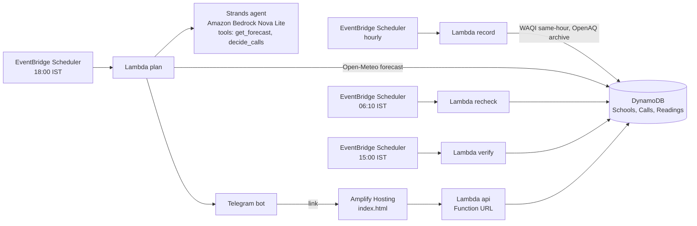

# Ghanti

**Should the children go outside tomorrow?** Every evening Ghanti answers that for every outdoor period of one school's day, from tomorrow's hour-by-hour air forecast, and tells the PE teacher on Telegram. Every afternoon it checks the nearest government monitor and records whether each call was right.

**Built for:** the PE teacher of a primary school in Rohini, Delhi. The location, the air, the monitors, the calls and the ledger are real. The timetable is illustrative, modelled on a typical Delhi school day, because no school had shared theirs by submission; it is labelled as such on every page.

**Live:** https://main.d3brqy16xi3d2g.amplifyapp.com

## The problem in one picture

In a North Indian winter the school day starts in the dirtiest air of the day. Same school, same day, modelled PM2.5 at the Rohini coordinates for last winter: about 140 ug/m3 at 8 AM, about 65 at 2 PM. Assembly and junior PE are at 7:50 and 8:30. Nobody at a school looks at air by the hour; the timetable was written in April.

## What happens every day

```
18:00  forecast for tomorrow (hourly PM2.5)  ->  rules  ->  one message to the coordinator and the teacher
       teacher taps OK, or Can't with a reason (test, teaching elsewhere, ground taken)  ->  only the affected period re-plans
06:10  nearest station's latest reading vs the forecast  ->  update the call if they disagree by more than 40%
15:00  measured air during each period  ->  was the call right?  ->  ledger (fills in whenever station data arrives)
```

## What you see on the page

```
+---------------------------------------------------------------+
| Ghanti   Should the children go outside tomorrow?      LIVE   |
| [Tomorrow's plan] [Try your school] [A smog week]             |
|                                                               |
| 1. 6 PM forecast   2. one call per period   3. 3 PM check     |
| Running live for Sector 9 Public School, Rohini. Built on ... |
|                                                               |
| THE PLAN   Next school day: Monday, 12 October                |
|   "Of 5 outdoor periods: 1 goes ahead but kept short, 4 go    |
|    ahead as planned. Air 52 to 67 ug/m3, Satisfactory to      |
|    Moderate."   [63][66][67][65][62][57][57][54][53][52][52]  |
|                                                               |
| PERIOD BY PERIOD                                              |
|   07:50  Morning assembly  ... why ...      Go outdoors  67   |
|   08:30  PE, Class 2B      ... why ...      Outdoors, short   |
|   > Hour-by-hour picture (expand)                             |
|                                                               |
| WHAT THE TEACHER RECEIVED   [phone]   What happens next       |
| TRACK RECORD   5 of 5 calls were right   [ledger table]       |
| > Where the data comes from (expand)                          |
+---------------------------------------------------------------+
```

- **Tomorrow's plan** (`/#/`): the question, how it works in three steps, the next school day's call as one sentence plus an hour band, one row per period with the verdict in words (Go outdoors, Outdoors keep it short, Move to 13:20, Stay indoors), the Telegram message, the track record. The two-row chart (periods before and after the call over the hourly air) and the agent trace are behind expanders.
- **Teacher view** (`/#/t/<token>`, the link in the Telegram message): the same rows with two buttons, OK or Can't. Can't reveals three reasons; only that period re-plans and the coordinator is told. No login; the one-time token is the auth.
- **Try your school** (`/#/try`): any coordinates and periods, a date picker, a one-tap smog day (12 Nov 2025). Same rules, live forecast, nothing stored.
- **A smog week** (`/#/replay`): the same school on 10-14 Nov 2025, modelled air, computed live when the page opens. Labelled as a replay.

## Status (updated Oct 10, 2026, 16:00 IST)

| Part | State |
|---|---|
| Hourly station recorder | Live since Oct 9 14:00 IST; 52 readings stored (22 same-hour, 30 archive) |
| 6 PM call to Telegram | Live; Oct 9 for Oct 10 (all outdoors), Oct 10 for Monday Oct 12 (one period kept short) |
| Strands agent (Nova Lite) plans the day | Live since Oct 10: calls get_forecast and decide_calls tools, writes the opening; the rules write the per-period lines; prose that contradicts a call is dropped and the trace says so; deterministic fallback if the agent fails |
| Teacher reply and re-plan | Live |
| 6 AM re-check | Live; first run Oct 10 06:10, no change needed |
| 3 PM verify and ledger | Live; first run Oct 10 15:00: 5 calls checked, 5 right (forecast 53-59, measured 49-63) |
| School timetable | Illustrative (typical Delhi school day); real location, Rohini Sector 9, Delhi |
| Replay week | Modelled air (CAMS), Nov 10-14 2025, 23 periods, 8 moves, 4 indoors; labelled on screen |
| Try your school (sandbox) | Live, stateless, any coordinates, no model call |
| Voice, WhatsApp, SMS to strangers, logins, Step Functions | Not built |

## Data, stated plainly

- **Forecast:** CAMS global model via Open-Meteo, about 45 km grid, updated every 12 hours. A model, not a station. Field `pm2_5`, not the 24-hour `us_aqi`.
- **Station, same hour:** Shaheed Sukhdev College of Business Studies, Rohini (DPCC), 1.2 km from the school, via the World Air Quality Index project (aqicn.org), read every hour. Raw polls are not republished; pages show per-period means and right/wrong only. Measured on Oct 9: outside Delhi-NCR this feed has been dark since 23 June 2026, and the code refuses any station more than 30 km away.
- **Station, archive:** DTU, New Delhi (CPCB), 3.0 km from the school, via OpenAQ, hourly averages. For India these arrive one to two days late (43 hours on Oct 9) and then replace the same-hour values in the ledger.
- **Bands:** India's NAQI PM2.5 breakpoints (a 24-hour standard) applied to hourly values. A simplification, said on screen. Children up to age 10 get the stricter rule in the 61-90 band.
- **Breathing rates:** US EPA Exposure Factors Handbook, chapter 6, ages 6 to under 11. Indoor factor 0.7 is an assumption.
- **The call is rules** (`backend/ghanti/rules.py`, 14 unit tests). A Strands agent on Amazon Nova Lite fetches the forecast and asks the rules through tools, then writes the opening of the message; the per-period lines are generated from the rules, so the message cannot contradict a call. If the opening claims a move or indoors the rules did not make, it is dropped and the template is used. If the agent fails, the deterministic path is used. Either way the trace is shown on the page.

## Run it

```
make setup      # uv venv + deps
make test       # 14 unit tests on the rules
make local      # tomorrow's real forecast for the seed school, the rules, the message. No AWS needed.
```

Deploy (your own AWS account, SAM CLI, a filled `.env` from `.env.example`):

```
make deploy && make outputs   # paste ApiUrl into frontend/index.html, table names into .env
make seed && make replay      # live school and the replay week
make plan                     # tonight's call by hand; the schedule does it at 18:00 IST
```

## Architecture



Region: Mumbai (ap-south-1). Everything is in `template.yaml`; `sam deploy` builds all of it.

## Honest notes

- SMS to Indian numbers through AWS reaches only our own verified numbers and cannot receive replies, so teachers get a Telegram message with a link. SMS in the video, if shown, is to our own phone.
- In a clean week the live call is "go outdoors" for nearly every period, and that is what the first two real calls said. The smog week shows a winter week, labelled as a replay.
- Judges can try any school at `/#/try`. It uses the live forecast, the same rules, and templated text, and stores nothing.
- There is no login. The public page shows nothing private, and the teacher acts through a one-time link; chat IDs are never returned by the API.

## Attribution

Forecast data from Open-Meteo (CAMS, Copernicus). Same-hour station data from the World Air Quality Index project. Archive station data from OpenAQ. Monitors operated by CPCB and DPCC.
