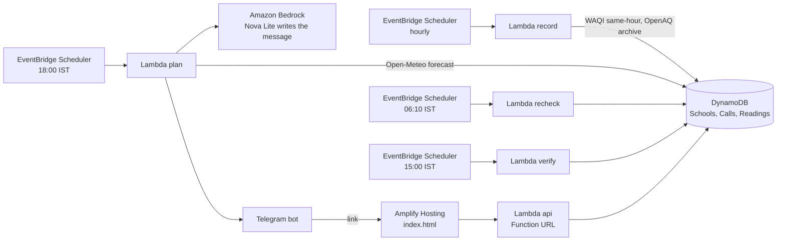

# Ghanti

Every evening Ghanti tells one PE teacher whether tomorrow's assembly, PE and practice happen outdoors, indoors, or later in the day. Every afternoon it checks the nearest official monitor and says whether the call was right.

**Built for:** the PE teacher of a primary school in Rohini, Delhi. The location, the air, the monitors, the calls and the ledger are real. The timetable is illustrative, modelled on a typical Delhi school day, because no school had shared theirs by submission; it is labelled as such on every page.

**Live:** https://main.d3brqy16xi3d2g.amplifyapp.com

## The problem in one picture

In a North Indian winter the school day starts in the dirtiest air of the day. Same school, same day, modelled PM2.5 at the Rohini coordinates for last winter: about 140 ug/m3 at 8 AM, about 65 at 2 PM. Assembly and junior PE are at 7:50 and 8:30. Nobody at a school looks at air by the hour; the timetable was written in April.

## What happens every day

```
18:00  forecast for tomorrow (hourly PM2.5)  ->  rules  ->  one message to the coordinator and the teacher
       teacher taps OK, or Can't with a reason (test, teaching elsewhere, ground taken)  ->  only the affected slots re-plan
06:10  nearest station's latest reading vs the forecast  ->  update the call if they disagree by more than 40%
15:00  measured air during each slot  ->  was the call right?  ->  ledger (fills in whenever station data arrives)
```

## Status (updated Oct 9, 2026, 15:00 IST)

| Part | State |
|---|---|
| Hourly station recorder | Live since Oct 9 14:00 IST; 31 readings stored (1 same-hour, 30 archive) |
| 6 PM call to Telegram, written by Amazon Nova | Live; first real call sent Oct 9 for Oct 10 (all five slots OUTDOORS, 54-58 ug/m3) |
| Teacher reply and re-plan | Live |
| 6 AM re-check | Scheduled; first run Oct 10 |
| 3 PM verify and ledger | Scheduled; first run Oct 10 |
| School timetable | Illustrative (typical Delhi school day); real location, Rohini Sector 9, Delhi |
| Replay week | Modelled air (CAMS), Nov 10-14 2025, 23 rows, 8 moves, 4 indoors; labelled on screen |
| Try your school (sandbox) | Live, stateless, any coordinates, no model call |
| Voice, WhatsApp, SMS to strangers, logins, Step Functions | Not built |

## Data, stated plainly

- **Forecast:** CAMS global model via Open-Meteo, about 45 km grid, updated every 12 hours. A model, not a station. Field `pm2_5`, not the 24-hour `us_aqi`.
- **Station, same hour:** Shaheed Sukhdev College of Business Studies, Rohini (DPCC), 1.2 km from the school, via the World Air Quality Index project (aqicn.org), read every hour. Raw polls are not republished; pages show per-slot means and right/wrong only. Measured on Oct 9: outside Delhi-NCR this feed has been dark since 23 June 2026, and the code refuses any station more than 30 km away.
- **Station, archive:** DTU, New Delhi (CPCB), 3.0 km from the school, via OpenAQ, hourly averages. For India these arrive one to two days late (43 hours on Oct 9) and then replace the same-hour values in the ledger.
- **Bands:** India's NAQI PM2.5 breakpoints (a 24-hour standard) applied to hourly values. A simplification, said on screen. Children up to age 10 get the stricter rule in the 61-90 band.
- **Breathing rates:** US EPA Exposure Factors Handbook, chapter 6, ages 6 to under 11. Indoor factor 0.7 is an assumption.
- **The call is rules** (`backend/ghanti/rules.py`, 13 unit tests). Amazon Nova only writes the message and never changes a call; if it fails, a template is used and logged.

## Run it

```
make setup      # uv venv + deps
make test       # 13 unit tests on the rules
make local      # tomorrow's real forecast for the seed school, the rules, the message. No AWS needed.
```

Deploy (your own AWS account, SAM CLI, a filled `.env` from `.env.example`):

```
make deploy && make outputs   # paste ApiUrl into frontend/index.html, table names into .env
make seed && make replay      # live school and the replay week
make plan                     # tonight's call by hand; the schedule does it at 18:00 IST
```

## Architecture



Region: Mumbai (ap-south-1). Everything is in `template.yaml`; `sam deploy` builds all of it.

## Honest notes

- SMS to Indian numbers through AWS reaches only our own verified numbers and cannot receive replies, so teachers get a Telegram message with a link. SMS in the video, if shown, is to our own phone.
- In a clean week the live call is "outdoors" for every slot, and that is what the first real call said. The replay shows a winter week, labelled as a replay.
- Judges can try any school at `/#/try`. It uses the live forecast, the same rules, and templated text, and stores nothing.

## Attribution

Forecast data from Open-Meteo (CAMS, Copernicus). Same-hour station data from the World Air Quality Index project. Archive station data from OpenAQ. Monitors operated by CPCB and DPCC.
